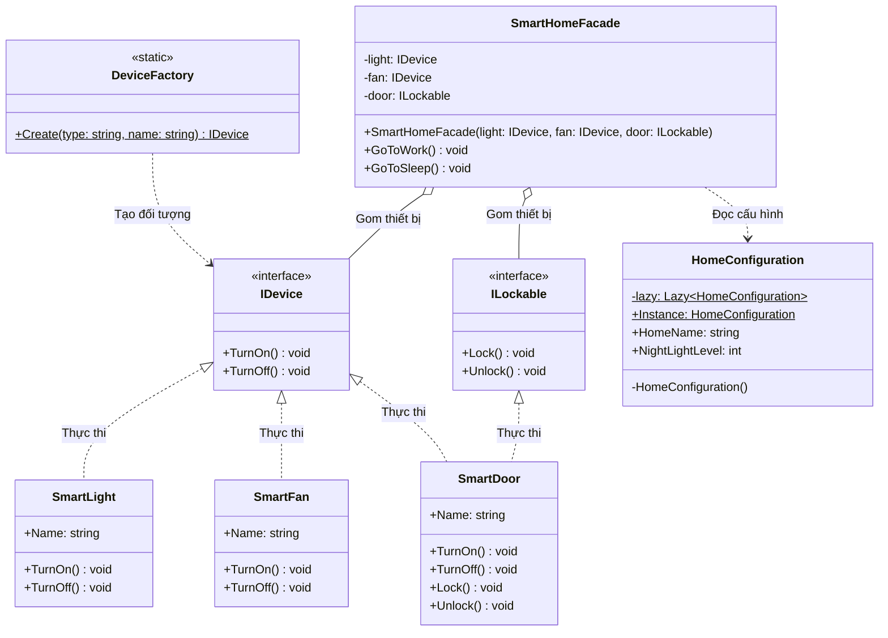
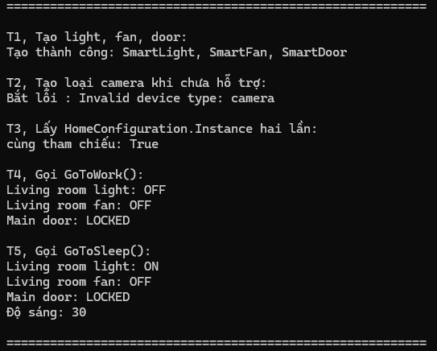

# Bài 10

Mã sinh viên: 202418989

Họ tên: Chu Đình Thi

Link GitHub: https://github.com/thivaiv/Bai10-HDT

Link phiên làm việc AI: https://share.gemini.google/H1uahqGBENSI

## Phân tích và thiết kế

### A. Mô tả các class và interface

#### 1. Interface IDevice
- Trách nhiệm: Định nghĩa các hành vi điều khiển cơ bản (bật/tắt) chung cho mọi thiết bị trong ngôi nhà thông minh.
- Phương thức: `TurnOn()`, `TurnOff()`.
- Quan hệ: Làm interface cơ sở cho `SmartLight`, `SmartFan`, `SmartDoor`.

#### 2. Interface ILockable
- Trách nhiệm: Định nghĩa các hành vi chuyên biệt cho thiết bị có chức năng khóa/mở khóa. Tách riêng vs `IDevice` để tuân thủ nguyên lý phân tách giao diện (ISP).
- Phương thức: `Lock()`, `Unlock()`.
- Quan hệ: Được thực thi bởi `SmartDoor`.

#### 3. Class SmartLight
- Trách nhiệm: Quản lý thiết bị đèn thông minh, thực hiện bật và tắt đèn.
- Thuộc tính: `Name` (chuỗi định danh thiết bị).
- Phương thức: `TurnOn()`, `TurnOff()` (in trạng thái ra console).
- Quan hệ: Thực thi interface `IDevice`.

#### 4. Class SmartFan
- Trách nhiệm: Quản lý thiết bị quạt thông minh, thực hiện bật và tắt quạt.
- Thuộc tính: `Name` (chuỗi định danh thiết bị).
- Phương thức: `TurnOn()`, `TurnOff()` (in trạng thái ra console).
- Quan hệ: Thực thi interface `IDevice`.

#### 5. Class SmartDoor
- Trách nhiệm: Quản lý thiết bị cửa thông minh, vừa có thể bật/tắt nguồn vừa có khả năng khóa/mở khóa an toàn.
- Thuộc tính: `Name` (chuỗi định danh thiết bị).
- Phương thức: `TurnOn()`, `TurnOff()`, `Lock()`, `Unlock()`.
- Quan hệ: Thực thi cả 2 interface `IDevice` và `ILockable`.

#### 6. Class DeviceFactory (Factory Pattern)
- Trách nhiệm: Đóng gói logic tạo đối tượng thiết bị, tách biệt việc khởi tạo khỏi client.
- Phương thức tĩnh: `Create(string type, string name)` trả về `IDevice`.
- Bắt lỗi: Kiểm tra chuỗi rỗng và ném `ArgumentException` nếu loại thiết bị ko hợp lệ.

#### 7. Class HomeConfiguration (Singleton Pattern)
- Trách nhiệm: Lưu trữ và quản lý cấu hình chung duy nhất cho toàn bộ ngôi nhà (tên nhà, độ sáng ban đêm).
- Thuộc tính: `Instance` (truy cập tĩnh), `HomeName`, `NightLightLevel`.
- Đặc điểm: Class được đánh dấu `sealed`, hàm tạo `private` và dùng `Lazy<HomeConfiguration>` để đảm bảo an toàn đa luồng và khởi tạo lười.

#### 8. Class SmartHomeFacade (Facade Pattern)
- Trách nhiệm: Cung cấp giao diện mức cao đơn giản hóa, gom nhóm các thao tác điều khiển thiết bị phức tạp thành các kịch bản tiện ích.
- Thuộc tính: Giữ tham chiếu đến `light` (`IDevice`), `fan` (`IDevice`), `door` (`ILockable`).
- Phương thức: `GoToWork()` (tắt đèn, tắt quạt, khóa cửa) và `GoToSleep()` (tắt quạt, khóa cửa, bật đèn ngủ theo độ sáng từ `HomeConfiguration`).

---

### B. Ba mẫu thiết kế (Design Patterns) áp dụng

#### 1. Factory Pattern
- Vị trí sử dụng: Lớp `DeviceFactory`.
- Lợi ích đạt được: Client ko cần gọi `new` trực tiếp đến từng lớp cụ thể (`SmartLight`, `SmartFan`, `SmartDoor`). Client chỉ cần tương tác qua interface trừu tượng `IDevice` và truyền tham số dạng chuỗi, giúp giảm phụ thuộc (loose coupling).
- Hạn chế: Mỗi lần muốn bổ sung 1 thiết bị mới (như `SmartCamera`), ta bắt buộc phải sửa đổi câu lệnh `switch` trong `DeviceFactory`, vi phạm nguyên lý Open/Closed (OCP).

#### 2. Singleton Pattern
- Vị trí sử dụng: Lớp `HomeConfiguration`.
- Lợi ích đạt được: Đảm bảo toàn bộ hệ thống chỉ tồn tại duy nhất 1 thể hiện cấu hình, tránh xung đột dữ liệu và cung cấp 1 điểm truy cập toàn cục thuận tiện (`HomeConfiguration.Instance`).
- Hạn chế: Tạo ra trạng thái toàn cục (global state) làm cho việc viết Unit Test gặp khó khăn (các bài test có thể bị ảnh hưởng lẫn nhau do dùng chung 1 instance) và khó tạo đối tượng giả lập (Mocking).

#### 3. Facade Pattern
- Vị trí sử dụng: Lớp `SmartHomeFacade`.
- Lợi ích đạt được: Cung cấp các thao tác ngữ cảnh mức cao (`GoToWork`, `GoToSleep`), giúp client chỉ cần gọi 1 hàm duy nhất thay vì phải tự ghi nhớ và gọi tuần tự từng thao tác trên từng thiết bị riêng lẻ.
- Hạn chế: Lớp Facade có nguy cơ trở thành một "God Object" nếu hệ thống mở rộng thêm quá nhiều thiết bị và kịch bản, dẫn đến việc Facade phải ôm đồm quá nhiều phụ thuộc.

---

### C. Sơ đồ thiết kế (Class diagram)

---

### D. Ảnh chạy chương trình

